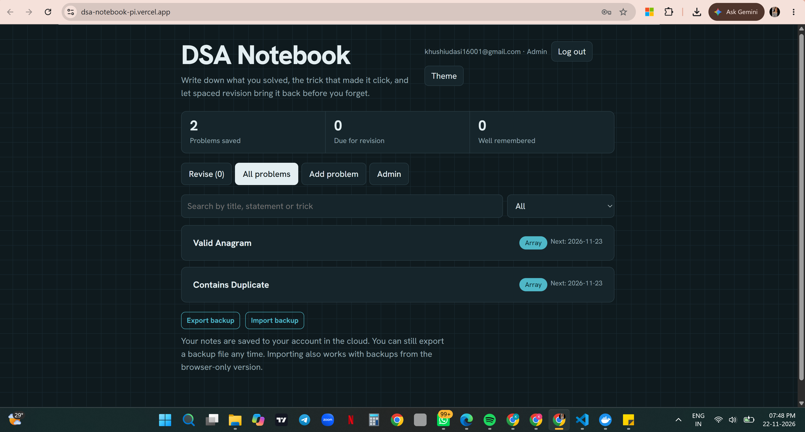

# DSA Notebook

A spaced-repetition notebook for data structures and algorithms problems. Save each problem with its statement, approach, complexity and the trick that made it click, then revise it just before you would forget it.

**Stack:** Java 17, Spring Boot 3, Spring Security (JWT), Spring Data JPA, PostgreSQL, React (Vite), Docker, GitHub Actions.

## Features

- Register and log in. Each user only sees their own problems (JWT, BCrypt password hashing).
- **Roles:** `USER` and `ADMIN`. Admins get an Admin tab to see every user, when they joined and last logged in, how many problems they solved and which ones, promote or demote users, and disable or enable accounts. Admins never see another user's notes or code, only titles, topics, difficulty and review progress.
- Role changes and disabling take effect immediately, because the API checks the user in the database on every request.
- Add, edit, search and filter problems by topic.
- Revision mode: you see only the problem, try to recall, then reveal the answer and mark it remembered or forgotten.
- Spaced repetition schedule: 1, 3, 7, 14, 30, then 60 days. Forgetting resets a problem to tomorrow.
- Export and import JSON backups.
- Light and dark theme.

## Architecture

```
React (Vercel)  -->  Spring Boot REST API (Render, Docker)  -->  PostgreSQL (Neon)
                          JWT auth + ReviewScheduler
```

| Endpoint | Purpose |
|---|---|
| `POST /api/auth/register`, `POST /api/auth/login` | Returns a JWT |
| `GET/POST /api/problems` | List and create |
| `PUT/DELETE /api/problems/{id}` | Update and delete (owner only) |
| `POST /api/problems/{id}/review?remembered=true` | Records a review and schedules the next one |
| `POST /api/problems/import` | Bulk import from a JSON backup |
| `GET /api/me` | Current user and role |
| `GET /api/admin/users`, `GET /api/admin/stats` | Admin only: user list and totals |
| `GET /api/admin/users/{id}/problems` | Admin only: what a user has solved (metadata only) |
| `PUT /api/admin/users/{id}/role`, `PUT /api/admin/users/{id}/enabled` | Admin only: manage a user |
| `GET /actuator/health` | Health check |

## Run locally

Requirements: Docker, Node 18+.

```bash
docker compose up --build          # Postgres + API on :8080
cd frontend
cp .env.example .env
npm install && npm run dev         # UI on :5173
```

Run tests: `cd backend && mvn test`

## Configuration (environment variables for the API)

| Variable | Meaning |
|---|---|
| `DB_URL` | JDBC URL, e.g. `jdbc:postgresql://host/dbname?sslmode=require` |
| `DB_USER`, `DB_PASSWORD` | Database credentials |
| `JWT_SECRET` | Random string of 32+ characters |
| `ADMIN_EMAIL` | The account that registers (or logs in) with this email becomes the first admin |
| `FRONTEND_URL` | Allowed browser origin(s) for CORS, e.g. `https://your-app.vercel.app`. Separate multiple origins with commas; the local default allows `http://localhost:5173` and `http://localhost:5174`. |

The frontend reads `VITE_API_URL` (the API base URL) at build time.

## Free deployment

See the steps below. All three services have free plans, but limits change, so check each pricing page.

1. **Database (Neon):** create a project, copy the host, user, password and database name.
2. **API (Render):** New Web Service from this repo. Language Docker, root directory `backend`, instance type Free, health check path `/actuator/health`. Add the environment variables above.
3. **Frontend (Vercel):** import this repo, root directory `frontend`, set `VITE_API_URL` to your Render URL.
4. Set `FRONTEND_URL` on Render to your Vercel URL and redeploy.

The free Render service sleeps after about 15 minutes idle, so the first request can take around a minute. An uptime monitor that pings `/actuator/health` can keep it awake.

## Design decisions

- **Why JWT?** The API is stateless, so it runs fine on a free host that sleeps and restarts.
- **Why check the user in the database on each request?** A role stored only inside the JWT would stay valid until the token expires, so a disabled or demoted user would keep access. One indexed lookup per request is cheap and makes admin actions instant.
- **Why can’t admins change their own role?** It prevents locking yourself out by accident.
- **Why does the client send its local date?** "Tomorrow" must match the user's time zone, not the server's (UTC).
- **Why a pure `ReviewScheduler` class?** The scheduling rule has no framework dependencies, so it is unit tested without a database.
- **Memory:** the JVM heap is capped in the Dockerfile and the connection pool is small, so the app fits a 512 MB free instance.
